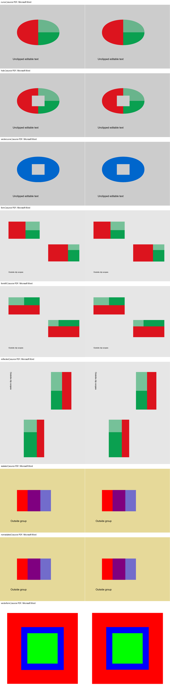

# Document quality corpus

`tests/writers/test_pdf_unicode.py` constructs a project-owned OpenType font at
runtime with `fi` and `ti` ligatures. Its native Story PDF checks repeated text
and exact RGB pixel equality before/after ToUnicode restoration. No third-party
font is shipped; ambiguous or unknown glyph decompositions are negative controls.

The primary corpus is generated from source instead of storing opaque binary fixtures. Run:

```powershell
uv run python -m tests.corpus.scientific_report
uv run python -m tests.corpus.multiformat
```

The primary `scientific_report` fixture covers portrait and landscape sections,
named styles, numbering, headers and a page-number footer, hyperlinks, merged
tables, raster and SVG images, native OMML, and a footnote. Archive timestamps and
document metadata are fixed so identical dependencies produce identical bytes.

`multiformat.py` adds deterministic PDF, PPTX and EMF fixtures. It covers fixed PDF
page geometry, two-column text, tables, raster/vector commands, presentation text,
charts, tables, speaker notes and a native EMF package relationship. Nested chart
workbooks and outer OOXML archives have normalized timestamps, so two builds are
byte-identical.

`office/libreoffice-scientific-slides.pptx` is a committed compatibility profile
opened and re-saved by LibreOffice. Its producer/version, SHA-256 and expected WMF
part are recorded in `office/manifest.json`; the source content is generated by
`multiformat.py`.

Structural expectations live in `scientific_report.golden.json` and
`multiformat.golden.json`. Visual checks combine tolerant page occupancy bounds
with committed images under `visual/`. The perceptual regression normalizes page
size and antialiasing, then checks mean absolute similarity, difference-hash
distance and foreground intersection-over-union against explicit thresholds in
`visual/manifest.json`.

Regenerate page references only after reviewing an intentional visual change:

```powershell
uv run python -m tests.corpus.visual_references
```

`charts.py` builds a pure `DocumentModel` corpus of 14 rich chart fixtures (dual
axes, trendlines, error bars, per-point colors, combo, percent data labels).
Charts render deterministically through `pdf_writer` (fitz.Story) into PNG pages
compared perceptually against committed golden images in `visual/charts/`. The
per-chart pages and their thresholds live in `visual/charts/manifest.json`.

Regenerate chart references only after reviewing an intentional chart change:

```powershell
uv run python -m tests.corpus.charts
```

## Office provenance fixtures

`libreoffice-scientific-slides.pptx` is the reproducible source presentation from
`tests.corpus.multiformat`, opened and re-saved by LibreOffice 25.8.6.2 on Windows.
It contains only project-generated content. ZIP timestamps are normalized after
the office-suite roundtrip; the producer metadata and converted WMF media part are
left untouched. `manifest.json` records provenance, size, SHA-256 and structural
expectations.

The fixture is intentionally committed because office-suite serialization cannot
be reproduced in CI without that exact application and version. Source-first PDF,
PPTX and EMF fixtures remain generated during tests and require no office suite.

## Нативные fixtures

Каталог: `tests/corpus/native/`.

Созданы для этого проекта, без внешних документов и пользовательских данных.

- `native-edit.docx`: генератор `fixture_bytes` в `tests/native/test_docx_access.py`;
  split runs, header/footer, объединения, вложенная таблица, собственный PNG, OMML и секции.
- `zero-opacity.pdf`: PyMuPDF, страница 100×100 points, прямоугольник (10,10,90,90),
  красная заливка и синяя обводка с alpha=0. Приёмка: alpha сохраняется, raster белый.
- `vector-export.pdf`: та же геометрия с alpha=1. Приёмка: нативный экспорт сохраняет
  paint, геометрию и пиксели без растровых изображений.
- `unsupported-vector.json`: собственная модель с неизвестной командой. Приёмка:
  явное отклонение и сохранение прежнего выходного файла; surrogate проверяется отдельно.
- `text-pages.pdf`: собственные две страницы PyMuPDF с текстом Native PDF и второй
  страницей с поворотом 90°. Проверяет установленный extra pdf-text без PyMuPDF.

Файлы являются тестовыми входами, а не временными сборками. Контрольные SHA-256
вычисляются тестами для проверки неизменности частей и транзакций.

## DOCX: исходные ширины и smartTag

`tests/readers/test_docx_layout_roundtrip.py` создаёт собственные smartTag и таблицу
20×3 с колонками 10/80/10, длинным текстом средней колонки и фиксированным layout.
Два JSON roundtrip проверяются независимым чтением `word/document.xml`:
видимый текст, оболочка, `tblW`, `tcW` и grid widths. Отдельно проверены
`auto`, `nil`, процентная запись и явное изменение ширины ячейки.

Локальная приёмка Microsoft Word 16.0 build 16.0.17932 подтвердила одну страницу
во всех трёх файлах каждого случая, совпадение текста и ширины 48/384/48 pt
в таблице. Исходники открываются только для чтения, их SHA-256 не меняется.
Проверка не является полной визуальной приёмкой или проверкой произвольного DOCX.

Повторить при установленном Word:

```powershell
uv run --frozen pytest tests/readers/test_docx_layout_roundtrip.py --basetemp=.opendoc-formats/docx-word
./tools/docx_word_acceptance.ps1 -FixtureRoot .opendoc-formats/docx-word
```

Word — отдельная локальная программа; её отсутствие не заменяет проверку XML
и не означает выполненной нативной приёмки в CI.

## PPTX: нативные свойства фона, линий и таблицы

`tests/readers/test_pptx_visual_roundtrip.py` создаёт собственные слайды со
сплошным фоном в slide/layout/master, двумя осевыми freeform paths и таблицей
с наследуемым цветом текста. Проверяются два JSON roundtrip, приоритет ближайшего
фона, отсутствие мутации источника, размеры и сохранение editable custGeom,
отсутствие пустого `solidFill` для неуказанного цвета.

Microsoft PowerPoint 16.0 build 17932 подтвердил равенство нативных свойств
во всех трёх файлах каждого случая: RGB фона, типы/позиции/размеры фигур,
текст и цвета ячеек. Источники открываются read-only, SHA-256 не меняется.
Это не пиксельная или полная семантическая приёмка и не проверка всех тем Office.

```powershell
uv run --frozen pytest tests/readers/test_pptx_visual_roundtrip.py --basetemp=.opendoc-formats/pptx-native
./tools/pptx_visual_acceptance.ps1 -FixtureRoot .opendoc-formats/pptx-native
```

PowerPoint устанавливается отдельно; CI выполняет проверки XML и модели,
а локальная нативная проверка требует установленной программы.

## PDF: размещения растра и обрезка

`tests/writers/test_pdf_raster_roundtrip.py` самостоятельно создаёт растровые
страницы с рамкой и диагональю, повторяет один xref на двух страницах, размещает
несколько разноцветных изображений и обрезает страницу. Тесты охватывают
четвертьобороты изображения/страницы, soft mask и JSON.

После каждого из двух циклов результат сравнивается с оригиналом, а не только
с предыдущим результатом: число страниц/размещений, page rect/rotation, image bbox
и все RGB pixel bytes. Исходные bytes не изменяются. Отдельно проверены явная
правка геометрии, отмена и отклонение unsupported transform с сохранением старого файла.
Для этого конечного профиля результат пиксельно совпадает в проверенном PyMuPDF.
Другой raster engine и произвольный PDF не считаются проверенными этим тестом.

## HTML: язык и семантика таблиц

`tests/readers/test_html_accessibility.py` создаёт собственные документы,
выполняет два цикла через публичные API и JSON и сравнивает lang (в том числе
пустой и вложенный), caption/форматирование, th/scope/headers/IDs, группы строк,
заголовки, нумерацию и внутренние ссылки. Вложенные таблицы и пустая подпись
проверены отдельно; опасные символы в атрибутах экранируются. ARIA вне профиля
получает расположенный loss. Это структурная приёмка, без доказательства
браузерного accessibility tree или работы экранного диктора.

## DOCX: общая предпочтительная ширина

`tests/readers/test_docx_typed_widths.py` проверяет абсолютные и относительные
предпочтения таблиц/ячеек, physical units, отсутствие type, ноль, auto/nil,
отсутствующую ширину, два JSON/DOCX цикла, точную native запись и неизменность
исходника/модели. Старые JSON проходят публичный импорт до правки/удаления.
Отрицательная native ширина остаётся расширением. Прежний тест неверной ширины
проверяет сохранение старого результата при отказе.

`tools/docx_word_acceptance.ps1` подтверждает прежний текст, одну страницу и
колонки 48/384/48 pt. `tools/docx_typed_width_acceptance.ps1` открывает четыре
результата правок read-only в Word 16.0, проверяет preferred types и значения:
75.001% и 12.125 pt отображаются API Word как 75% и 12.1 pt. Точный XML сохраняется;
это дискретность Word, без утверждения о точном полном визуальном рендере.

```powershell
uv run --frozen pytest tests/readers/test_docx_typed_widths.py --basetemp=.opendoc-formats/width-native
./tools/docx_typed_width_acceptance.ps1 -FixtureRoot .opendoc-formats/width-native
```

## DOCX: формальная роль заголовка

`tests/readers/test_docx_headings.py` создаёт собственные документы с уровнями
1/2/3/9 без именованного стиля, native Heading 2, наследуемым пользовательским
стилем, прямым override и основным текстом. Проверяются JSON и два DOCX цикла,
document defaults, смена/удаление роли, неверные уровни и защита старого результата.
`tools/docx_heading_acceptance.ps1` открывает исходник и два результата read-only
в установленном Word, сверяет уровни структуры. Для явно изменённых ролей
сравнивает текст, имя/размер/цвет шрифта и интервалы с исходником. SHA-256 файлов
не меняется. Это конечная проверка свойств, без полной визуальной приёмки Word.

```powershell
uv run --frozen pytest tests/readers/test_docx_headings.py --basetemp=.opendoc-formats/heading-native
./tools/docx_heading_acceptance.ps1 -FixtureRoot .opendoc-formats/heading-native
```

## PDF: affine, обрезка и поток изображений

`tests/writers/test_pdf_raster_roundtrip.py` сравнивает два цикла с независимо
заданными native matrices для произвольного поворота, shear и отражений:
совпадают исходные RGB bytes и geometry. Невырожденность проверяется отдельно.
`tests/writers/test_pdf_docx_rasters.py` проверяет ImageCrop и углы 3/12.5/-17/90
по независимому Form-reference. Из-за двойного clipping у reference допускаются
различия антиалиасинга только в пределах 1.5 pixels от границы, а не внутри изображения.

Настоящие PDF → JSON → PDF циклы с поворотами страниц/изображений сохраняют
crop и RGB pixels точно. Собственные DOCX проверяют положение изображения
между абзацами, перенос на следующие страницы, центрирование, колонтитулы,
located LOSS для paragraph anchor и отказ при пустой обрезке, чрезмерной
рамке и PNG pixel dimensions. Исходник и модель не изменяются.

## PDF: общий outline и нативные закладки

`tests/writers/test_pdf_outline.py` создаёт собственный PDF с nested entries,
page/URI/unknown destinations, точками, zoom и bold. Два PDF → JSON → PDF цикла
сравнивают исходную иерархию, номера страниц и destination points для 0/90/180/270
градусов, с crop и без него. Исходник и модель не меняются. Body paragraph anchor
проверяется на реально следующей странице; удаление не оставляет bookmarks.
Прежний JSON мигрирует один раз, сохраняет native raw данные и не восстанавливает
явно удалённый outline. Минимальный установленный pdf-rich профиль проверяет
настоящие закладки без дополнительных движков.

## PDF: отдельные MediaBox/CropBox

`tests/writers/test_pdf_page_geometry.py` создаёт собственный растровый документ
с нулевым, положительным и отрицательным native MediaBox origin, crop и всеми
четырьмя поворотами. Два PDF → JSON → PDF цикла сравнивают MediaBox, CropBox,
viewport rect, rotation и все RGB bytes; источник и модель не меняются.
Typed crop/rotation edits сравниваются с независимо изменённым native PDF.
Удалённая декларация не восстанавливает старые области/поворот. Layout links
сохраняют native rectangles и internal destinations при переносе; unknown null
outline points остаются unknown вместо NaN или произвольной точки backend-а.
Минимальный installed pdf-rich профиль проверяет общий тип и реальные crop cycles.

## PDF → DOCX: обрезка, Form XObject и группы

`tests/writers/test_pdf_docx_graphics.py` создаёт независимые PDF с вложенными
Form, разными обрезками общего ресурса, поворотами страницы/формы, отражением,
кубическими контурами, even-odd отверстием и прозрачными пересечениями внутри
нейтральной isolated/nonisolated группы. Проверяются исходные RGBA bytes,
границы scope, два DOCX/JSON цикла и неизменность входной Model. Растр остаётся
исходным PNG внутри SVG; векторная обрезка не получает растрового представления.

Негативные примеры: knockout, nonseparable blend, пересекающая текст
обрезка, stencil, preblended `/Matte`, повреждённые ссылки/команды/bounds/alpha
и лимит вложенности. Текст внутри полностью содержащего его clip Form остаётся
редактируемым; внешний текст не наследует clip формы.
Отказ сохраняет прежний файл; source PDF удерживается при неизвестной композиции.
Нативный PDF writer продолжает отклонять неподдержанный не-прямоугольный clip.

Сравнение с исходными PDF выполняется в Microsoft Word 16.0, build 16.0.17932,
с независимым Poppler 96 dpi. Девять примеров частного проектора включают растр/вектор,
отверстие, reflected Form и обе нейтральные группы. Два нативных DOCX/JSON цикла
дают попиксельно одинаковые страницы Word. Это проверка конечного профиля,
а не утверждение о попиксельном равенстве разных движков PDF и Word.
Границы кубических контуров отличаются от заданного оригинала до 0,041 pt.
Проверка нативного изменения crop/position использует сохранение встроенного
шрифта в Word: обе полные страницы двух циклов совпадают с нативно изменённым
оригиналом. Удаление программы шрифта проверяется как отдельное ограничение.



Это визуальная приёмка проектора. Строгий маршрут дополнительно требует сохранения
нативной структуры групп: одинаковые картинки без независимо редактируемой группы,
её clip и isolation получают LOSS и отказ. Нейтральная группа сама по себе
не означает отсутствия этих ограничений.

## Общая прозрачность и typed scopes

`tests/writers/test_pdf_group_scopes.py` проверяет официальный scene API SDK:
исходный полный Unicode, clips/occurrences, JSON, правку opacity, удаление
group/clip/scene без возврата legacy, порядок children, лимиты и атомарный отказ.
48 сочетаний двенадцати separable режимов, isolated/nonisolated и двух alpha фона
проверяют цвета пяти областей независимых PDF, созданных PDF-операторами.
MuPDF сравнивает исходный PDF с аналитической SVG-проекцией с допуском 3/255.
Дополнительная проверка всех 48 исходников Poppler даёт максимум 2/255.
Проверяется вложенная общая opacity; SVG не содержит filters, image и group opacity.
Отдельные оригиналы отличают технологический запас `bboxlog` от реального
контура глифа: clip внутри запаса допускается, пересечение контура меньше чем
на 1 pt отказывает. Используются измерения нативного glyph API, без вычитания
предполагаемого запаса. Повторный PDF/JSON экспорт AcroForm остаётся отдельным
прежним профилем и проходит без ложной mixed scope сцены.

Word 16.0: opacity .5, Multiply, Screen, nonisolated фон и снятый typed clip
проверены относительно исходных PDF через Poppler 96 dpi. Цвета внутренних
областей отличаются до 2/255, два нативных DOCX/JSON цикла дают попиксельно
одинаковые страницы. Печатные PDF Word не содержат растровых image XObjects.
Внешний текст и строка после удаления clip остаются редактируемыми.
Исходные typed группы сохраняются в Model; DOCX-проекция — один векторный SVG,
без нативного управления отдельными детьми/композицией группы. Обычный экспорт
и строгий конвертер помечают потерю структуры как LOSS и отказывают до публикации.
Проверки Word/SVG относятся к экспериментальному частному представлению,
а не к принятому маршруту без потерь.

Нативная `wpg:wgp` с двумя отдельными фигурами также проверена в Word:
`a:effectDag/a:alphaModFix amt="50000"` применяет общую opacity, но печатный
PDF содержит image XObject вместо векторной группы. Вариант с вложенным
`a:cont` даёт тот же результат; контрольная группа без эффекта остаётся векторной.
Наличие эффекта в схеме DrawingML не подтверждает векторный вывод Word.
Такое представление не принимается как маршрут без потерь качества.

Knockout не принят: при красном opaque и синем alpha=.5 прямоугольниках,
`/I true /K true /CS /DeviceRGB` MuPDF даёт RGB (116,109,203) в пересечении,
Poppler — (127,0,128), PDFium — (128,0,127). Совпадение с одним движком
недостаточно. Смысл knockout сохраняется в SDK/JSON, DOCX отказывает.
Частичная обрезка глифов также отказывает: Word игнорирует правую границу
`horzOverflow="clip"`; поворот текстового блока может приводить к растеризации.
Скрытая часть текста не удаляется и не появляется в успешном экспорте без
явного снятия typed clip. Эти ограничения остаются в OF17.

## Редактируемые группы и цветовое пространство

`tests/writers/test_docx_vector_groups.py` использует официальный Model 0.16.0,
конечный WPC/WPG профиль и независимый XML из документа, созданного непосредственно
в Microsoft Word. `tests/corpus/native/word-canvas-group.xml` содержит только
собственные геометрию и заливки; личные метаданные и пакет шаблона не включены.
Проверяются фон полотна, имена и порядок детей, собственная alpha, правка цвета,
перенос, удаление и два JSON/DOCX цикла. Активная сцена не подменяется старым SVG;
общая opacity/ICC/unknown, непроверенные эффекты/расширения и глубокая вложенность
отклоняются. PDF-тест допускает нативную группу только после явных typed правок,
снимающих исходные clip/общую opacity, и не выдаёт их за сохранение исходного PDF.

В Word 16.0 полотно имеет Shape.Type=20; группа доступна отдельно как
CanvasItems.Item(...).Type=6 с двумя GroupItems. Контроль `wpg:grpSp` сохранял
XML, но не отдельную промежуточную группу в интерфейсе. Проверены: собственная
сцена адаптера, независимый Word-оригинал и документ после нативного переноса
группы/ребёнка и перекрашивания ребёнка. Два цикла каждого из трёх документов
дали попиксельно одинаковые страницы Word при независимом рендере MuPDF и
Poppler 144 dpi. Печатные PDF не содержат image XObjects. Внутренние цвета
контрольных областей совпали с независимыми PDF-примитивами. Эти результаты
подтверждают только описанный профиль, а не общую прозрачность или Form clipping.
Нативную структуру, геометрию и заливки сравнивает
`tools/docx_group_acceptance.ps1 -FixtureRoot .opendoc-formats/native-groups`:
`source.docx`, `cycle-0.docx`, `cycle-1.docx` создаются из `scene_document()`
и двух публичных JSON/DOCX циклов. Параметр `-Names` позволяет проверить
независимый Word-оригинал или нативно изменённый документ с его циклами.
Скрипт открывает только собственные fixtures, не меняет их и печатает PDF;
отсутствие image XObjects и сравнение страниц проверяются отдельным PDF renderer.

Штатная `Group.Fill.Transparency=.5` также не заменяет общий эффект: Word создаёт
групповую заливку `a:solidFill` и переводит детей на `a:grpFill`, теряя их
разные цвета/собственную alpha. В контрольном пересечении получается RGB
(57,54,38), а не исходная композиция. Векторный вывод такого варианта не
означает сохранения качества; этот обход в writer не применяется.

`tests/writers/test_pdf_group_color_space.py` проверяет закрытый C-GRAPHICS-02:
официальную декларацию, два JSON-цикла, правку/удаление и unknown/Gray/CMYK.
Старое нативное свидетельство RGB не восстанавливает удалённую декларацию.
Унаследованное PDF-пространство разрешает Formats в явно объявленном RGB device
профиле; отсутствующая декларация старого документа остаётся неизвестной.

## Нативные списки TeX

`tests/writers/test_latex_lists.py` проверяет C-LIST-02 Model 0.17.0:
продолжения без нового номера, пустой родитель, вложенные списки, начало и
перезапуск нумерации, выход из списка, правку и удаление официальной роли.
Два JSON/TeX цикла сохраняют Anchor, ListItem и текст; Office imports запрещены
в контрольном тесте. Несогласованные counters/metadata, custom labels и
непредставимое расположение связей приводят к атомарному отказу.

`tests/writers/test_latex_list_acceptance.py` независимо компилирует три собственных
оригинала и по два нативных цикла через `pdflatex -no-shell-escape`.
MuPDF сравнивает страницы попиксельно при 108 dpi и проверяет отсутствие image
XObjects. В набор входят продолжения, пустой родитель и пустой листовой пункт,
перезапуск счётчика и смешанная вложенность. Эта проверка включена в Linux CI
Python 3.12; TeX distribution не является runtime-зависимостью.
Она подтверждает только конечный профиль, а не произвольные macros, labels,
формулы, таблицы или компоновку. Другие экспортеры явно сообщают LOSS общей
структуры списка; quality gate может отклонить публикацию такого результата.

## Нативные формулы TeX

`tests/writers/test_latex_math.py` проверяет точные value/format/display/fallback,
text/formula порядок и paragraph boundaries, формулы внутри пунктов/продолжений
списка, отдельные Formula blocks, правку режима и выражения, удаление, два JSON/TeX цикла и запрет Office
imports. Неподдержанные команды/форматы/geometry, numbered environments,
непривязанные и повреждённые metadata, попытки file/shell/macro/`^^` синтаксиса
отклоняются до публикации. Fallback — inert metadata, не подмена выражения.

`tests/writers/test_latex_math_acceptance.py` компилирует четыре собственных оригинала
и по два JSON/TeX цикла через pdflatex с отключённым shell escape. Дроби, корни,
суммы/интегралы, матрицы, cases/aligned, оба display delimiter и формулы в списках
дают попиксельно одинаковые страницы MuPDF при 108 dpi; image XObjects отсутствуют.
Проверка работает в том же Linux CI профиле, что и списки; TeX distribution
не включается в пакет. MathML/OMML, FormulaTree, numbered equation/align,
произвольные macros/Unicode и moving arguments вне описанного профиля заголовков
не входят в принятую проекцию.

`tests/writers/test_latex_heading_acceptance.py` проверяет inline math в Heading 1–5,
numbered/starred команды, дроби/корни/греческие символы и матрицу. Для каждого
original и двух JSON/TeX циклов отдельная обёртка добавляет оглавление и выполняет
три прохода pdflatex, проверяя moving arguments через auxiliary files.
Страницы MuPDF при 108 dpi совпадают попиксельно без image XObjects.
Структурные тесты подтверждают правку/удаление Heading и значения формулы,
сохранение fallback и отказ для display в заголовке без Office imports.
