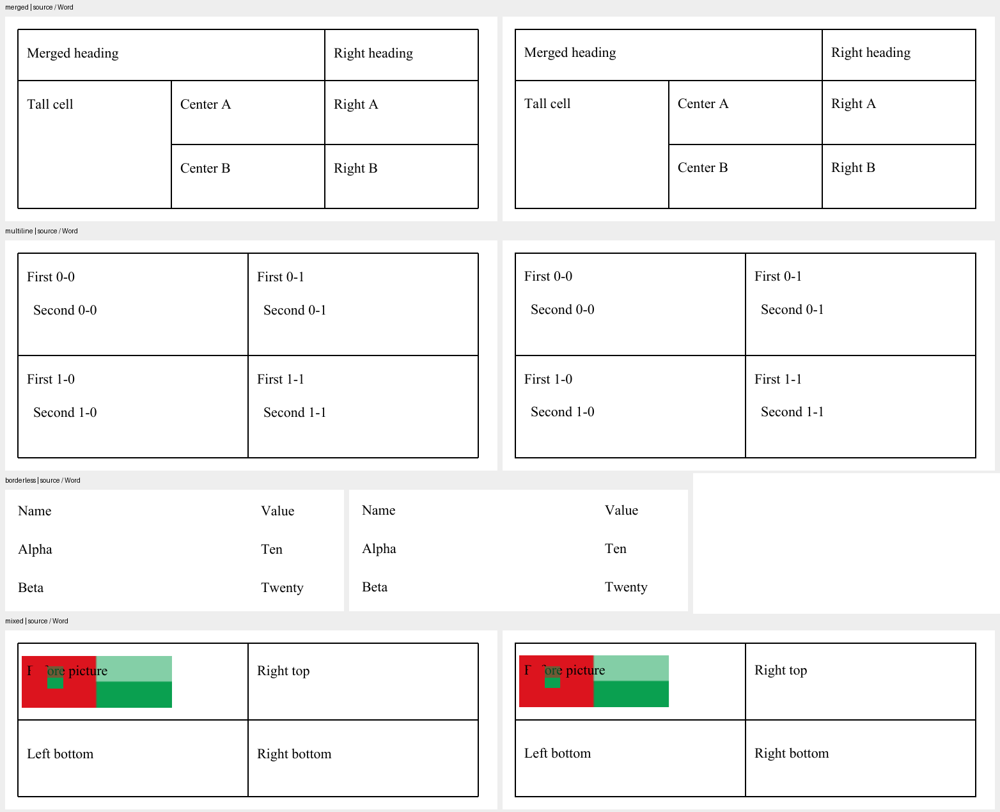

# Цвет, интервалы, отступы и табуляции Word

DOCX использует общий API OpenDoc 0.13.0: `TableIndent` принадлежит таблице,
`TabStops` — абзацу. Модель проверяет декларации и JSON, адаптер измеряет исходные
OOXML-значения и записывает нативные объявления. Codec и схема модели не дублируются.

```python
from opendoc_model import TableIndent, TabStop, TabStops, set_table_indent, set_tab_stops

set_table_indent(table, TableIndent(30))
set_tab_stops(paragraph, TabStops((TabStop(396, alignment="right", leader="line"),)))
# Явное удаление прямых объявлений:
set_table_indent(table, None)
set_tab_stops(paragraph, None)
```

Положительные и отрицательные позиции заданы в points; один twip равен 0,05 pt.
Ноль — явный отступ; `TableIndent(value_pt=None)` — неизвестное значение,
которое нельзя угадать при записи. Отсутствие декларации разрешает наследование.
Выравнивание таблицы сохраняется отдельно: отступ не означает одинаковый
визуальный сдвиг при любом выравнивании Word.

Общие alignment: `left`, `center`, `right`, `decimal`, `bar`.
Общие leader: `none`, `dot`, `dash`, `line`, `heavy`, `middle-dot`.
`line` переводится в нативный `underscore` согласно
[контракту OOXML](https://learn.microsoft.com/en-us/dotnet/api/documentformat.openxml.wordprocessing.tabstopleadercharvalues).
`TabStop(position_pt, kind="clear")` подавляет унаследованную явную позицию.
Неизвестные alignment/leader остаются `None`, а не превращаются в guessed defaults.
Нативные `start`/`end`/`num` удерживаются в opaque extra с расположенным LOSS;
из них не выводится известная межформатная alignment.

`TabStops(inherit=False)` материализуется как clear для текущих известных
explicit positions стилей и defaults. Это конечный нативный snapshot, поэтому
режим замены имеет расположенный `docx.tab-stops-materialized` LOSS. Новые
будущие style positions автоматически не подавляются. Обычный автоматический
интервал табуляции не изменяется. Неизвестное или циклическое наследование
отклоняется; fallback positions не угадываются.

Стили сохраняют native declarations в `style.properties['docx_tab_stops']`
(список position_pt/alignment/leader с именами OOXML), поскольку TextStyle
не является владельцем общего tagged TabStops. Прямые правки и удаление этого
native свойства меняют только tabs в копии исходной части стилей; остальные
объявления, basedOn и расширения сохраняются. Общий API нельзя записывать в
свойства объекта неправильного типа.

Позиции должны представляться точно в signed 32-bit twips. NaN, бесконечность,
boolean, неизвестные значения и более 256 explicit stops не принимаются.
Неподдержанные исходные объявления имеют native XPath в диагностике;
попытка записи без явной замены или удаления отклоняется до публикации.
При переходе в другой формат утрата отступа/табуляций имеет расположенный LOSS,
который может отклонить внешний нулевой бюджет качества.

Собственный пример принят в Word 16.0 build 16.0.17932: 30 pt и
396 pt/right/line, два DOCX/JSON цикла, правка и удаление. Полные страницы обоих
циклов совпадают с оригиналом попиксельно при Poppler 96 dpi. Нативная правка
в Word до 12 pt и 296 pt/center/dot сохраняется следующим публичным циклом.
Полный inherited/conditional table cascade, RTL layout и оформление
произвольного документа остаются в TODO.

Повторяемая Word-проверка: `tools/docx_direct_layout_acceptance.ps1` принимает
только собственные fixtures из `.opendoc-formats`, открывает исходники read-only,
проверяет SHA-256, измеряет native значения, экспортирует полные PDF-страницы
и редактирует отдельную копию. Вычисленные default stops отделены от явно
объявленных; фактический XML-инвентарь дополнительно проверяется тестами.

## Прямой и унаследованный цвет

`TextStyle.color` содержит прямую декларацию: `None` разрешает наследование,
`"auto"` сохраняет автоматический цвет Word, RGB задаёт конкретный цвет.
Автоматический цвет не заменяется чёрным RGB: Word выбирает отображение сам.
`Paragraph.style_id` и `TextStyle.properties['base_style_id']` связывают стили;
`effective_text_style` вычисляет цвет через общий API OpenDoc. Корневые стили
абзацев связаны с импортированным `__doc_defaults__`. Служебные снимки не
подавляют правки общего поля или удаление ссылок на стили.

Правка и удаление цвета в прямом оформлении, именованном стиле и docDefaults
меняют соответствующее нативное объявление. Сохраняются исходные ID стилей,
включая переименованные Word; новый стиль роли наследует исходный ID.
При неизменённом тематическом цвете удерживаются native fallback, theme и tint/shade;
новый RGB не получает старую тему. Остальная исходная часть стилей сохраняется.
При переходе в HTML/PDF/PPTX унаследованный RGB вычисляется в отдельной копии
модели для отображения; исходные декларации не изменяются. Утрата Word `auto`
имеет расположенный `color-auto` LOSS, включая унаследованный цвет.

## Межстрочный интервал

Конечный профиль использует общий `LineSpacing` Model: `minimum` и `exact`
в пунктах, `relative` как множитель. Прямая декларация отделена от вычисленного
наследования: `get_line_spacing` возвращает только собственное значение,
`resolve_line_spacing(..., document=model)` учитывает именованные стили и
связанные docDefaults. Codec и проверка деклараций остаются в OpenDoc Model.

```python
from opendoc_model import LineSpacing, set_line_spacing, get_line_spacing, resolve_line_spacing

set_line_spacing(paragraph, LineSpacing("minimum", 14))
set_line_spacing(model.styles["Ownbase"], LineSpacing("relative", 1.25))
set_line_spacing(paragraph, None)  # Удаление прямого значения возвращает наследование.
assert get_line_spacing(paragraph) is None
inherited = resolve_line_spacing(paragraph, document=model)
```

Общий контракт соответствует Word `atLeast` / `exact` / `auto`.
Прежние `line_spacing`, `line_spacing_pt`, `docx_line_spacing_rule` сохраняют
совместимость с нативными правками. При изменении общего объявления оно имеет
приоритет; неизменённый импорт допускает прежний способ правки.

`atLeast` означает минимум: 14 pt при тексте 24 pt не становится точным
интервалом 14 pt. Относительный интервал использует 240 единиц на одну строку,
абсолютный — 20 единиц на point. Исходные целые значения удерживаются без
повторного округления. Поддержаны положительные значения в signed 32-bit диапазоне.

Явная правка величины и правила отражается в DOCX. Для удаления прямого
интервала используется `set_line_spacing(owner, None)`. Прежний способ требует
удалить величину вместе с `docx_line_spacing_rule`.
Изменение или удаление интервала в стиле правит только соответствующие атрибуты
`w:spacing`; отступы до/после абзаца и остальные нативные свойства сохраняются.
Унаследованный интервал не превращается в прямой при неизменённом цикле.
Неизвестные правила и неподдержанные значения имеют нативный адрес в диагностике;
запись требует явной замены или удаления. Непредставимые изменения отклоняются
до публикации. Legacy DOCX без сохранённого правила и переход в другие форматы
имеют `docx.line-spacing-rule` LOSS; внешний нулевой бюджет сохраняет прежний файл.

Собственный пример с прямым auto, унаследованным тематическим RGB, минимумом,
точным и относительным интервалами прошёл два полных DOCX/JSON цикла в Word
16.0 build 16.0.17932. Полные страницы совпали с оригиналом при Poppler 96 dpi;
после нативной правки совпали все шесть абзацев и полная страница следующего цикла.
Проверка повторяется через `tools/docx_color_spacing_acceptance.ps1`.
Это приёмка указанного примера и профиля; условные стили таблиц, RTL и полная
точность отображения произвольного документа остаются в TODO.

## Отступы абзаца

`left_indent_pt`, `right_indent_pt`, `first_line_indent_pt` хранят прямые
объявления в пунктах. Отсутствие/None наследует значение; ноль — явное объявление.
Отрицательный `first_line_indent_pt` задаёт выступ. Изменение и удаление в
именованном paragraph style, абзаце и `__doc_defaults__` обновляет собственные
атрибуты `w:ind` в исходной части стилей и не закрепляет вычисленные значения
в дочерних стилях/абзацах. Другие свойства исходного XML сохраняются.

```python
model.styles["OwnIndentBase"].properties["left_indent_pt"] = 50
model.sections[0].blocks[1].properties.pop("left_indent_pt", None)
```

Конечный профиль использует целые twips с точностью 0.05 pt и величиной по
модулю меньше 2³¹ twips. Непредставимое значение, несовместимые native units,
логические start/end, символьные отступы и неоднозначные контейнеры дают адресный
`docx.paragraph-indent` ERROR. Для известных неподдержанных осей нужны явная
замена или None; неизвестное расширение требует нативного разрешения.
Character/table/inline styles не объявляют отступы в этом профиле и адресно
отказывают. Native opaque declarations учитываются при импорте и в LOSS
межформатного экспорта; TXT/LaTeX также сообщают потерю известных отступов.

Собственный трёхабзацный пример проверен в Word 16.0 build 16.0.17932.
Два полных DOCX/JSON цикла совпали с оригиналом по всем пикселям страницы при
Poppler 96 dpi. Правка трёх осей, удаление прямых/стилевых отступов и defaults
совпали с независимыми native references и после двух последующих циклов.
Нативные правки стиля и сброс абзаца в Word сохранились через два цикла.
Повторная проверка: `tools/docx_paragraph_indent_acceptance.ps1` на собственных
QA-файлах. HTML/PDF/PPTX/EPUB получают отдельное представление известных
вычисленных отступов без изменения исходной модели.

Остаток C-DOCX-05: полный условный и RTL каскад, геометрия/отступы таблиц
и внутритекстовое расположение. Приёмка
отступов указанного примера не доказывает точность произвольного Word-документа.

## Сравнение общей модели межстрочного интервала

Общее сравнение Model замечает изменение правила/величины интервала и потерю объявления,
включая наследуемую правку стиля. Неизвестные поля `LineSpacing.extra` сохраняются
в JSON, но не записываются в Word: адресный `line-spacing.extra` LOSS позволяет
внешнему нулевому бюджету отклонить результат. Непредставимые нативные величины
дают ERROR и сохраняют прежнее назначение. Переданный бюджет используется и
при чтении общего объявления, в стилях, вложенных таблицах и колонтитулах.

Два исходных цикла и нативные правки Word подтверждены для собственного примера:
полные страницы при Poppler 96 dpi совпали с оригиналом. Правка и удаление через
общий setter, изменение унаследованного стиля и docDefaults совпали с независимыми
нативными результатами; два последующих цикла правки стиля и удаления также
сохранили все пиксели страницы. Исходный exact 14 pt при тексте 24 pt намеренно
перекрывает строки: адаптер сохраняет это исходное оформление.
HTML/PDF/PPTX используют отдельное представление вычисленного интервала и цвета,
не меняя исходную модель; совместимость прежних правок удерживается. Полная
межформатная семантика minimum/exact/relative не заявляется: `line-spacing` LOSS
сохраняется за пределами DOCX и JSON. Условные стили и остальные нативные значения
остаются в TODO.

Общий интервал поддержан в абзаце, paragraph style и docDefaults. Объявление
в character/table style вне этого профиля адресно отказывает до публикации,
не выдавая игнорирование свойства за сохранение.


## Интервалы между абзацами и переносы

`space_before_pt`/`space_after_pt` задаются неотрицательными points с точностью
0,05 pt. `keep_together`, `keep_with_next`, `page_break_before`, `widow_control`
принимают только boolean. Они соответствуют Word `keepLines`, `keepNext`,
`pageBreakBefore`, `widowControl`. Это конечный профиль имеющихся свойств Model,
собственная схема или копия `opendoc-model` не создаётся.

Абзац, paragraph style и docDefaults содержат только свои прямые объявления.
Отсутствие свойства или `None` разрешает наследование; `0` и `False` остаются
явными значениями. `resolve_style` вычисляет стиль из общей модели; импорт не
записывает его результат в дочерний стиль или абзац. Правка и удаление обновляют
сохранённый исходный styles.xml, сохраняя другие оси `w:spacing` и line rule.
В character/table style и inline run такое объявление адресно отклоняется.

Нативные line units/auto-spacing, расширенные или неоднозначные объявления
остаются unknown. Неподдержанные единицы/значения дают `docx.paragraph-flow` LOSS
при импорте. Запись требует явной замены/удаления свойства; неизвестное расширение
нужно разрешить в нативном источнике. Отрицательные, дробные вне twips, строковые
или неподходящие boolean значения отклоняются до публикации назначения.

Собственный пример принят в Word 16.0 build 16.0.17932: оригинал, два DOCX/JSON
цикла, правка стиля, сброс прямого оформления, правка/удаление defaults. Полные RGB
страницы при Poppler 96 dpi совпали с оригиналом и независимыми native references;
реальные правки Word также прошли два цикла. До исправления правка стиля не
обновляла унаследованные значения. Инструмент повторной проверки:
`tools/docx_paragraph_flow_acceptance.ps1` на собственных QA-файлах.

HTML/EPUB/PPTX получают вычисленные интервалы в отдельном представлении без
изменения исходной модели; нативные флаги переноса между форматами не обещаются.
Для потерянных интервалов/флагов и unknown формируется `docx.paragraph-flow` LOSS,
который позволяет quality gate отклонить результат. Полная эквивалентность
пагинации произвольного документа этим конечным примером не доказана.

## PDF → OpenDoc → DOCX: рабочий кандидат

Собственный маршрут использует публичные чтение/запись Model:
`write_document(read_document(pdf_path).document, docx_path)`. Для рабочей версии
исходников нужны профили `pdf`, `docx`, `fonts`; форматные движки остаются
опциональными. Отдельный `PdfModelConverter` / `create_converter('opendoc')`
передаёт настройки чтения, проверки качества и отмены, проверяет неизменность
PDF перед публикацией. Прежний `pdf-docx` с pdf2docx пока сохраняется: полный
сравнительный профиль замены не закрыт. [Лицензии зависимостей](dependencies.md)
применяются и к этому маршруту; удаление обёртки не меняет лицензию PyMuPDF.

PDF-парсер сохраняет измеренную геометрию, встроенные шрифты и порядок рисования.
Адаптер создаёт отдельное представление для Word, не меняя исходную Model.
Текст остаётся редактируемым в нативных блоках DrawingML; таблицы — нативными
таблицами с горизонтальными/вертикальными объединениями и отдельными физическими
строками ячеек. Подтверждённые изолированные штрихи сетки становятся общими
`BorderSet` / `Border` и нативными границами ячеек. Если другая графика пересекает
сами штрихи, автоматическая проекция в границы не применяется. Такой вывод и
редактирование пересекающейся сетки вместе с таблицей ещё не приняты;
отдельные нулевой площади штрихи дают отказ.

У безрамочной таблицы невидимая рамка подгоняется под фактические метрики Word,
сохраняя исходные базовые линии и отступы строк. Встроенная программа шрифта имеет
приоритет; для невстроенных Base-14 объявляется `font-substitution`, а
сопоставление Word требует визуальной проверки. Для встроенной программы
назначается отдельное внутреннее имя Word: это предотвращает подмену Helvetica
и не переименовывает программу. После чтения DOCX стиль содержит нативное имя,
а FONT-ресурс — подлинную программу. Поднабор сохраняет copyright, license/URL
и локализованные записи имён. Model 0.14.0 хранит явную ссылку стиля на FONT-ресурс. Две программы
одного family/variant различаются по байтам нативно нарисованных глифов;
импорт DOCX восстанавливает ссылки из font table. Проверены правка, наследование
и два JSON/DOCX цикла с разными контурами глифов одного имени. Неполные имена
программы и неоднозначное соответствие без ссылки отклоняются. Контракт —
[C-FONT-01](../development/opendoc-proposals.md#c-font-01-ссылка-стиля-на-программу-шрифта).
Растры получают исходные размеры,
поворот/отражение, crop конечного измеренного профиля и отдельный порядок каждого
повторного размещения. JPEG сохраняется без перекодирования. Прямые RGB-сэмплы
и soft mask соединяются в lossless PNG без промежуточного premultiplied alpha.
Скан сохраняет свои пиксели; малого количества текста недостаточно для замены
страницы картинкой. Формульные глифы не объявляются восстановленным math AST.

Области обрезки измеряются отдельно для каждой операции рисования. Нативный
интерпретатор раскрывает Form XObject с его матрицей, ресурсами и вложенными
scope; повторные размещения сохраняют собственные области. Прямоугольная обрезка
в осях изображения становится `ImageCrop` и нативной рамкой Word, включая повороты
и отражение. Исходные пиксели и alpha остаются неизменными. Кубические контуры,
вложенные пересечения и even-odd отверстия сохраняются в отдельных SVG: растровая
картинка встраивается исходными PNG/JPEG bytes, вектор остаётся вектором.
Весь лист в растр не превращается.

Для Word кубические clip-кривые точно делятся на короткие кубические сегменты;
это обходит искажение длинной кривой при импорте SVG. Повышенный внутренний масштаб
SVG уменьшает округление контуров; `viewBox` и размер рамки Word остаются прежними.
Оба преобразования принадлежат проектору Formats. Общее содержимое Model не меняется.
Нейтральные группы Normal с opacity=1, knockout=false и известным RGB/Gray
пространством допускают сохранение отдельных объектов и их собственной alpha.
Собственная маска alpha проверяется по ресурсу и матрице; произвольная маска
не становится поддержанной только из-за сходства размеров.

Текст внутри Form остаётся редактируемым при подтверждённых шрифте/геометрии
и прямоугольном clip, полностью содержащем его видимые bounds. Пересекающая
глифы обрезка, общая прозрачность/knockout/blend сложной смешанной группы требуют
[C-GRAPHICS-01](../development/opendoc-proposals.md#c-graphics-01-общая-обрезка-и-композиция-смешанной-группы).
PDF parsing и Word projection остаются в Formats; Model владеет общей семантикой,
валидацией, ссылками и codec. Нативный PDF writer сохраняет собственный конечный
профиль: наличие SVG-проекции Word не снимает его прежние ограничения.

Собственные независимые оригиналы с объединениями, многострочными/безрамочными
ячейками, прозрачными/повторными/повёрнутыми изображениями и наложением на текст
проверяются в Word относительно PDF. В измеренных примерах отклонение начала
строк до 0,16 pt; округление печатного вывода и альфа-композиции может менять
цветовой канал на 1/255. Это не попиксельное равенство PDF и Word. Два нативных
DOCX/JSON цикла стабильны; после правки объединённой ячейки и перемещения одного
повторного растра страницы двух циклов совпали с Word-оригиналом попиксельно.



Это иллюстрация конечного профиля на независимых оригиналах, не оценка качества
произвольного PDF. Геометрия и видимые границы проверяются вместе с текстом.

Неизмеренные области/матрицы Form, частично обрезанный текст, stencil и произвольные
soft masks, ненейтральные группы/цветовые пространства, shears, повёрнутые таблицы,
preblended `/Matte` и color-key изображения без подтверждённой проекции,
повёрнутый текст ячеек и размеры/смещения глифов вне полупунктового шага Word,
отдельные нулевой площади штрихи вне подтверждённой сетки,
аннотации/поля PDF и outline без подтверждённой проекции в Word,
прозрачный/обводочный текст и графика, требующая одновременно двух разных
наложений на перекрываемый текст ячеек, пока отклоняются. Предыдущий файл
сохраняется при отказе, изменении PDF, отмене и превышении выбранных лимитов.
Развёртка разрежённых объединений ограничена `DocumentLimits.max_nodes` до
создания нативной сетки. `assessment_complete=False` означает, что полнота
сохранения произвольного PDF не подтверждена. [Граница библиотек и приёмка](../development/format-requests.md#c-pdf-docx-01-собственный-маршрут-и-граница-библиотек)
не переносит распознавание PDF или правила Word в OpenDoc Model.
